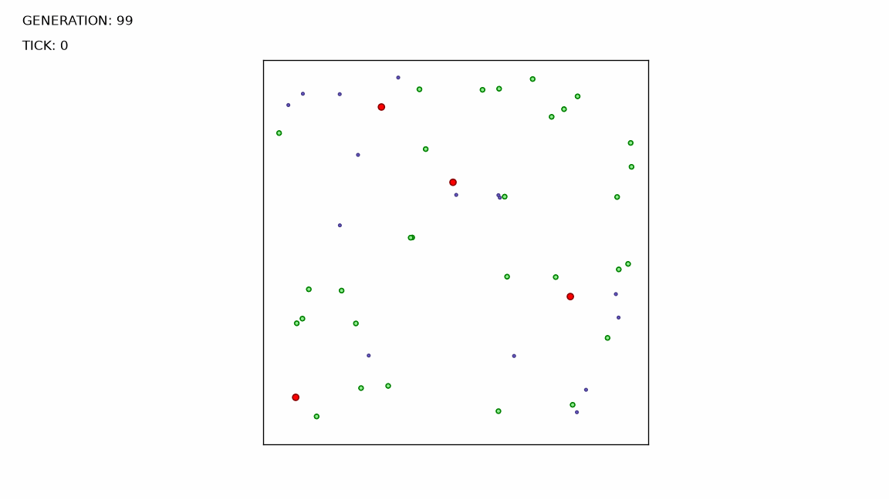

# Universe_26_evolution_simulator:
This application shows how machine learning could be used for simple organisms behavior simulation.

# Command line Execution:
Requires Python 3.12+.

1. navigate to application directory
2. run `$ pip install -r requirements.txt` to install all necessary dependencies
3. to run application use command `$ python run.py`

Results (fitness chart and generation gifs) are saved to the `results` folder.

